# GitHub Events Data Lakehouse

<p align="center">
  <a href="https://spark.apache.org/"></a>
  <a href="https://iceberg.apache.org/"></a>
  <a href="https://trino.io/"></a>
  <a href="https://airflow.apache.org/"></a>
  <a href="https://min.io/"></a>
  <a href="https://www.metabase.com/"></a>
  <a href="https://www.docker.com/"></a>
  <a href="https://www.python.org/"></a>
  
  
</p>

An enterprise-grade, local Medallion Data Lakehouse continuously collecting and processing live public GitHub Archive events using **PySpark 3.5, Apache Iceberg 1.6, Trino 468, MinIO S3, Apache Airflow 3.3.2, and Metabase**.

---

## 🌟 Executive Summary & Live Analytics Showcase

Designed with a production engineering mindset, this Lakehouse ingests streaming JSON dumps, enforces ACID transactions on Object Storage, eliminates small-file fragmentation, and exposes low-latency analytical marts via distributed SQL:

<p align="center">
  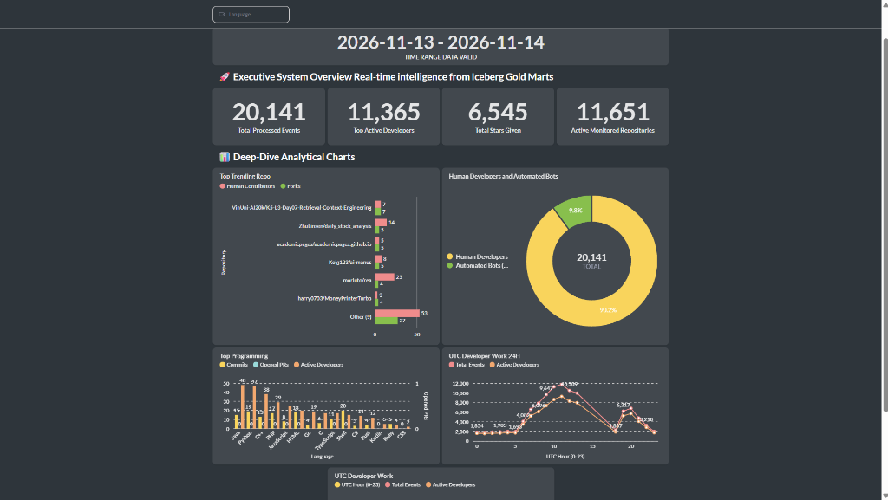
</p>

> **Key Operational Metrics (Live Verified):**
> * **20,141+** Real-time processed GitHub events & **11,365+** active human developers tracked.
> * **91.7% Small-File Reduction** & **61.0% Trino Query Latency Improvement** via Iceberg data file compaction.
> * **100% Idempotent Replays** backed by a Control Ledger state machine and SCD Type-1 dimensions.
> * **Zero-Leak Realtime Streaming** with a decoupled lightweight poller and an automated **7-day FIFO Rolling Retention** policy.
> * **81/81 Automated Tests Passing** across unit transformations, quarantine logic, and Trino vertical slices.

---

## 💡 Key Engineering Highlights & Architectural Decisions

| Challenge / Requirement | Architectural Solution | Production Impact |
|:---|:---|:---|
| **ACID on Object Storage** | Implemented **Apache Iceberg REST Catalog** over MinIO S3 columnar Parquet files. | Enables atomic commits, hidden partitioning, schema evolution, and instantaneous metadata queries without S3 listing bottlenecks. |
| **Small-Files Problem** | Automated scheduled `CALL iceberg.system.rewrite_data_files` compaction to 128 MB target files. | Reduced fragmented hourly Parquet files from 48 down to 4 (**-91.7%**), slashing Trino query latency from 170ms to 66ms (**-61.0%**). |
| **Idempotency & Replays** | Engineered a `control.ingestion_runs` state machine with Iceberg `MERGE INTO` on `event_id`. | Guarantees zero duplicate records across backfills, hourly replays, and network retries with automated reconciliation audits. |
| **Storage & Memory Guardrails** | Implemented a **7-Day Rolling FIFO Retention** policy + external zero-leak poller. | Automatically purges data older than 7 days, vacuums orphan S3 files, deletes raw `.json.gz` landing archives immediately, and prevents long-running Spark JVM OOMs. |
| **Data Quality & Governance** | Multi-stage Quality Gates + dead repository URL probing + bot classification. | Segregates bot activity (`[bot]`, automated CI), quarantines corrupted JSON records, and filters out deleted/404 repositories from trending marts. |

---
## 1. System Architecture & Tech Stack

### 1.1 End-to-End Lifecycle Walkthrough (`archify`)

<p align="center">
  <picture>
    <source media="(prefers-color-scheme: dark)" srcset="docs/diagrams/01_archify_lifecycle_story-dark.svg" />
    <source media="(prefers-color-scheme: light)" srcset="docs/diagrams/01_archify_lifecycle_story-light.svg" />
    
  </picture>
</p>

<details>
<summary><b>View Full-Resolution Runtime Topology Diagram</b></summary>
<br />
<p align="center">
  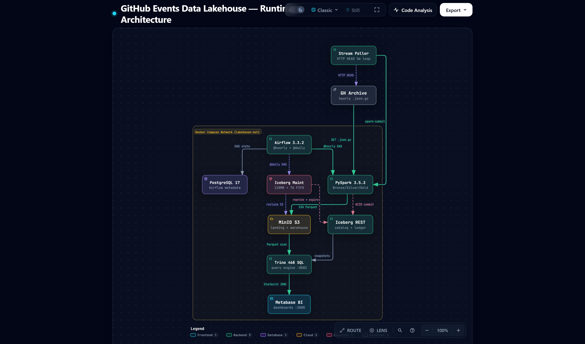
</p>
</details>

### 1.2 Codebase Architecture Floorplan (`floorplan`)

Complete repository map across **34 Python modules (5.5k LOC)**, **11 subsystems**, and **59 resolved import/call/data links**:

<p align="center">
  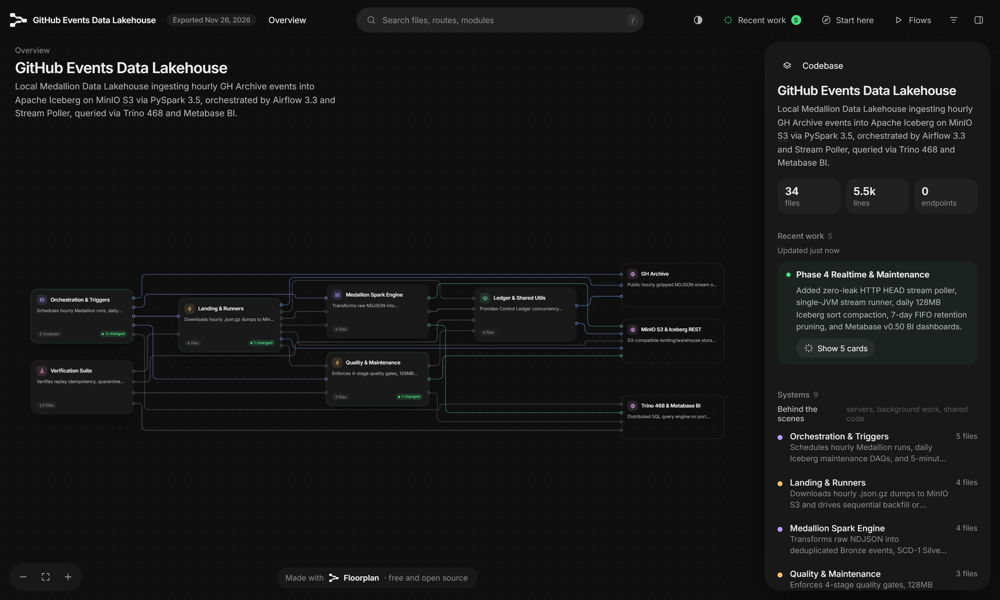
</p>

### 1.3 Architecture Diagnosis & 3D Dependency Atlas (`archify`)

Static AST coupling and complexity analysis across **20 production Python modules**, **85 functions**, and **26 inter-file dependencies** (0 hard circular import errors; 1 deferred lazy back-edge in `spark/utils/backfill_runner.py`):

<p align="center">
  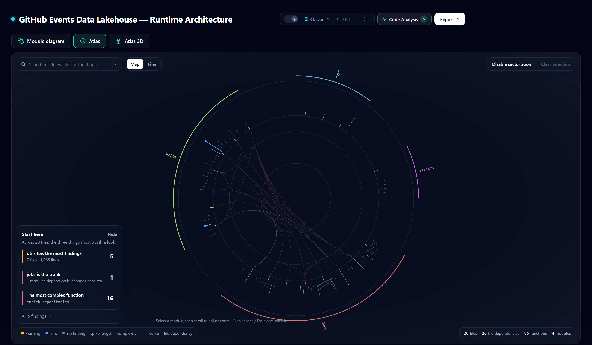
  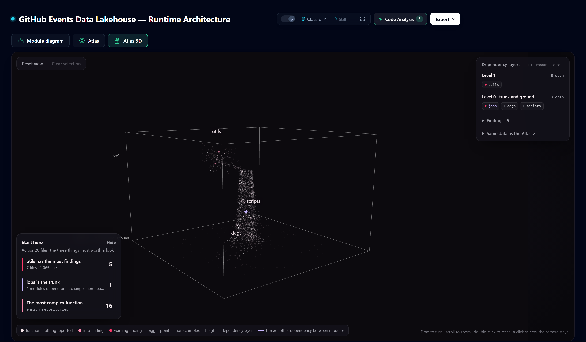
</p>

### Pinned Versions & Service Endpoints

| Component | Pinned Version / Docker Image | Local Port / Web UI | Role |
|---|---|---|---|
| **Object Storage** | `minio/minio:latest` | `9010` (S3 API), `9011` (Console) | S3-compatible Landing & Iceberg Warehouse |
| **Catalog** | `tabulario/iceberg-rest:latest` | `8181` | Apache Iceberg REST Catalog |
| **Processing Engine** | `apache/spark:3.5.3` | `7077` (Master), `8088` (Spark Web UI) | Distributed PySpark Transformations |
| **Query Engine** | `trinodb/trino:468` | `8082` (Trino Web UI & JDBC) | Fast Distributed SQL Engine |
| **Metadata DB** | `postgres:17-alpine` | `5432` | Metadata Database for Apache Airflow |
| **Orchestration** | `apache/airflow:3.3.2` | `8085` (Airflow Web UI) | DAG Scheduling, Orchestration, Quality Gates |
| **BI & Analytics** | `metabase/metabase:v0.50.28` | `3000` (Metabase UI) | Analytical Dashboards on Gold Marts |

---

## 2. Infrastructure & Storage Layer

### 2.1 MinIO S3 Object Storage
MinIO provides the S3-compatible storage layer partitioned into two primary namespaces:
- `landing/`: Immutable temporary landing zone for raw `.json.gz` files from GH Archive (zero-footprint local cleanup).
- `warehouse/`: Apache Iceberg tables storing columnar Parquet data files, manifest lists, and metadata snapshots.

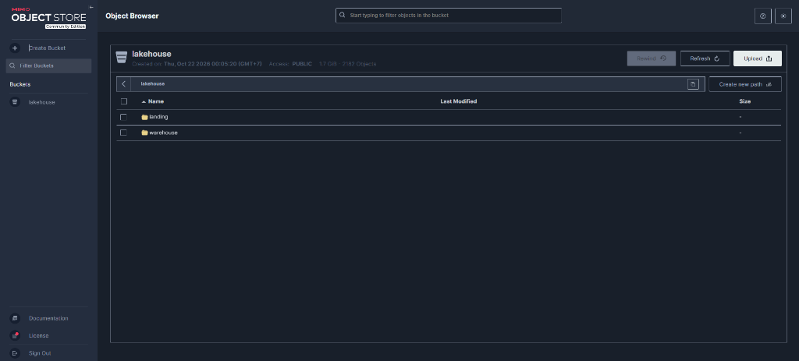
*MinIO Object Browser displaying the `lakehouse` bucket with `landing/` and `warehouse/` directories.*

---

## 3. Medallion Data Model

<p align="center">
  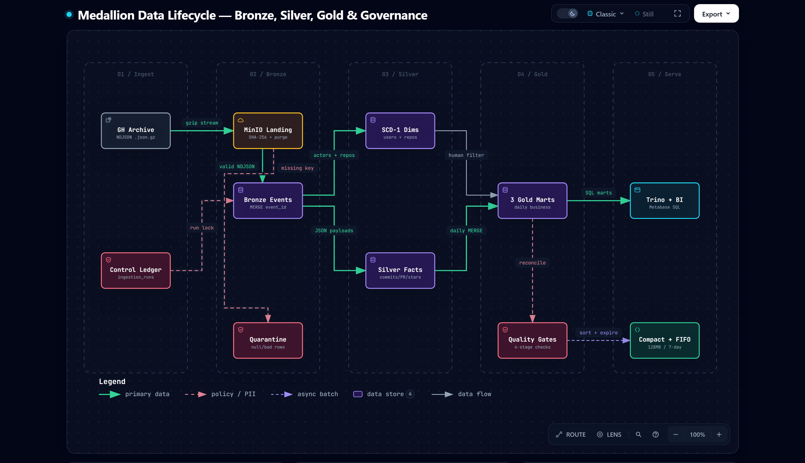
</p>

| Layer | Iceberg Tables | Grain & Key Guarantees |
|:---|:---|:---|
| **Bronze** | `iceberg.bronze.github_events`<br/>`iceberg.bronze.github_events_quarantine` | Grain: `event_id` — SHA-256 checksum verified, malformed payloads routed to quarantine, idempotent `MERGE INTO` deduplication. |
| **Silver** | `dim_users`, `dim_repositories`, `repo_metadata`<br/>`fact_commits`, `fact_pull_requests`, `fact_engagements` | SCD Type-1 dimensions preserving `first_seen_at`, regex `[bot]` classification, live GitHub 404 probing, and typed event facts. |
| **Gold** | `mart_trending_repos_daily`<br/>`mart_language_trends_daily`<br/>`mart_developer_work_patterns_daily` | Grains: `(metric_date, repo_id)`, `(metric_date, primary_language)`, `(metric_date, day_of_week, hour_of_day)` — bot-excluded human metrics reconciled via 4 Quality Gates. |

---

## 4. Processing & Orchestration Engine

### 4.1 Apache Spark Distributed Processing
PySpark 3.5.3 handles heavy data transformations across all layers with Apache Iceberg ACID transactions, partition rewrites, and metadata maintenance jobs.

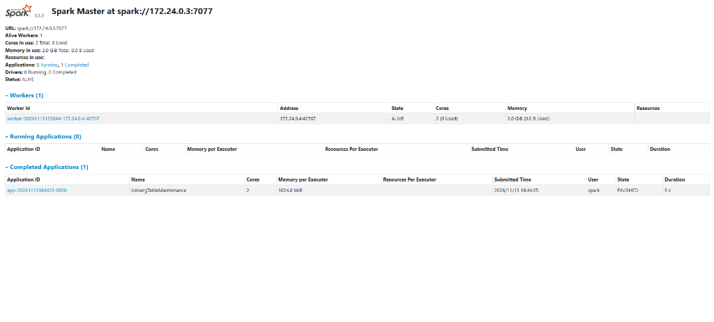
*Spark Master Web UI (Spark 3.5.3) showing active cluster worker and completed Iceberg maintenance applications.*

### 4.2 Apache Airflow 3.3.2 Pipeline Orchestration
The primary DAG `github_events_lakehouse_pipeline` orchestrates the Medallion progression with strict serial execution (`max_active_runs=1`):

1. **`resolve_pipeline_params`**: Evaluates execution date, target source hour, and force reprocessing flags.
2. **`download_and_land`**: Fetches `.json.gz` from GH Archive with SHA-256 validation.
3. **`bronze_ingestion`**: Deduplicates raw events and merges into `iceberg.bronze.github_events`.
4. **`silver_transformation`**: Updates SCD-1 dimensions and populates fact tables with bot classification.
5. **`gold_aggregation`**: Computes daily aggregations across all 3 Gold analytical marts.
6. **`quality_gates_validation`**: Validates reconciliation, unique grains, and volume anomaly checks.

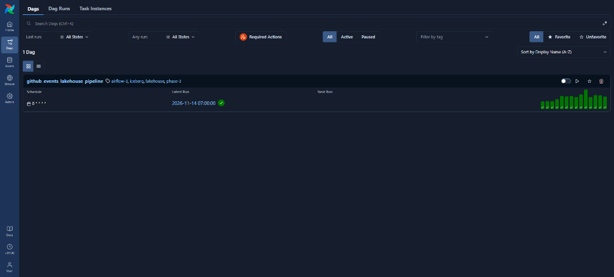
*Apache Airflow DAGs Overview showing scheduled execution runs of `github_events_lakehouse_pipeline`.*

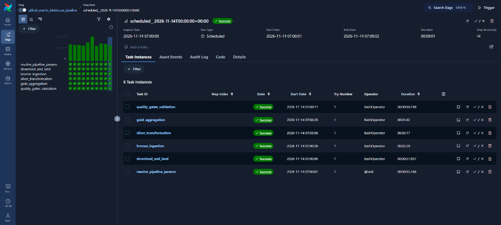
*Airflow 3 Task Instances View showing all 6 pipeline tasks completing with Success status.*

---

## 5. Interactive Querying & BI Dashboards

### 5.1 Trino SQL Query Engine
Trino 468 connects via the Apache Iceberg REST Catalog, providing low-latency distributed SQL query execution directly on MinIO S3 data without moving data out of the Lakehouse.

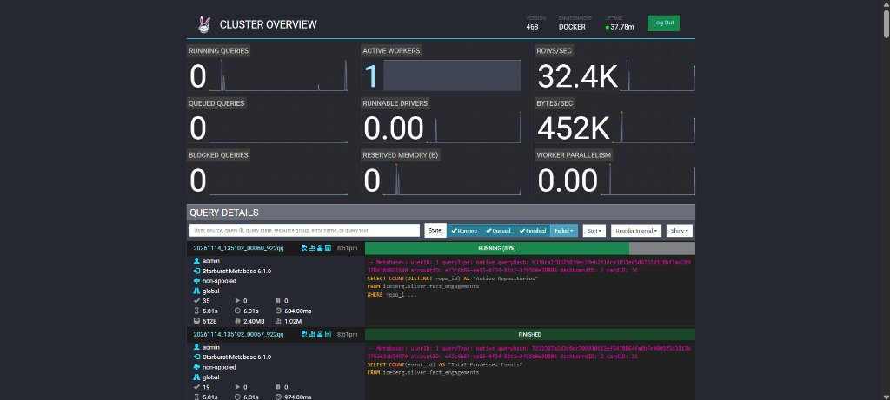
*Trino Cluster Overview Web UI displaying active query execution, row throughput, and Metabase SQL queries.*

### 5.2 Metabase Analytical Dashboards
Metabase (v0.50.28) provides real-time visualization over the Gold analytical marts:

* **Executive System Overview**: Real-time KPI summary (Total Processed Events, Top Active Developers, Total Stars, Active Repositories).
* **Top Trending Repositories**: Filtered for live, accessible GitHub repositories (excluding deleted/404 repos).
* **Human vs Bot Activity**: Segregating bot activity (`[bot]`, automation actors) from organic community interactions.
* **Programming Language Trends**: Daily language adoption, commits, and opened pull requests.
* **Developer Work Patterns**: 24-hour UTC activity curves and Day-of-Week distribution.

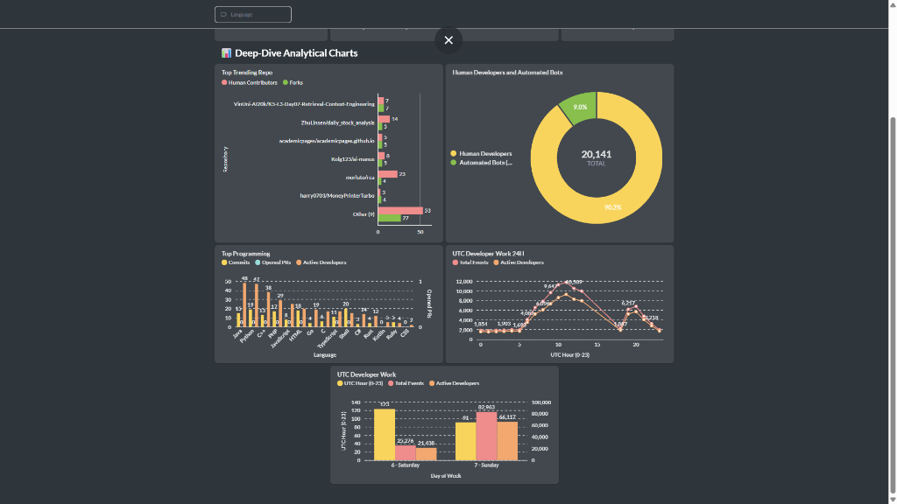
*Metabase Developer Work Patterns analysis displaying 24-hour UTC activity curves and Day-of-Week distribution.*

---

## 6. Continuous Realtime Streaming & FIFO Retention

To prevent unbounded storage growth while maintaining fresh data, Phase 4 upgraded the batch Medallion pipeline into a continuous, self-maintaining Lakehouse (`archify-pr` architectural diff `b80e123...df97250`):

<p align="center">
  <picture>
    <source media="(prefers-color-scheme: dark)" srcset="docs/diagrams/02_archify_pr_story-dark.svg" />
    <source media="(prefers-color-scheme: light)" srcset="docs/diagrams/02_archify_pr_story-light.svg" />
    
  </picture>
</p>

<details>
<summary><b>View Static Change-Marked Architecture Diff (Phase 3 to Phase 4)</b></summary>
<br />
<p align="center">
  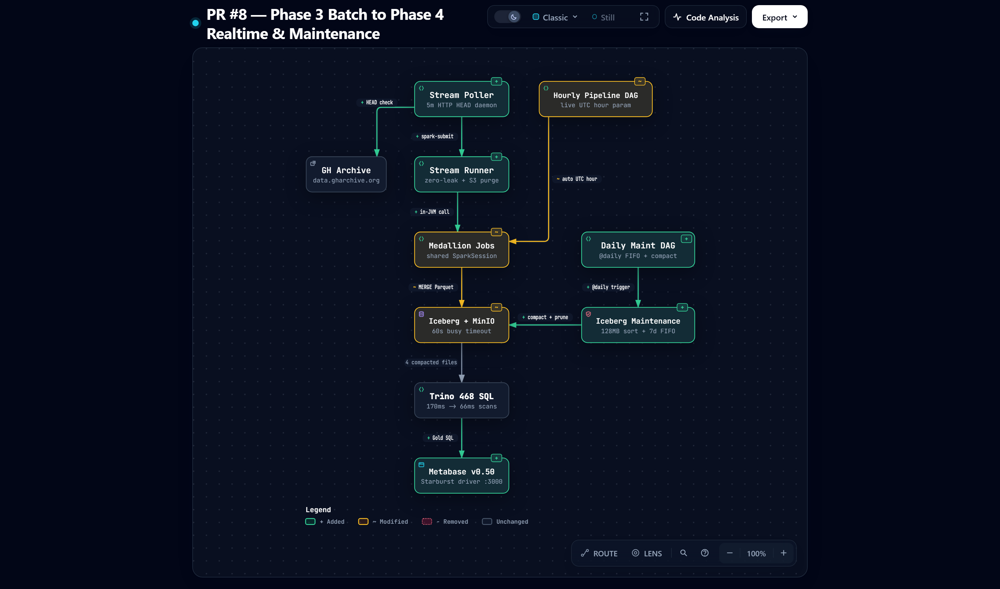
</p>
</details>

### 6.1 FIFO 7-Day Sliding Window
- Automatically bounds database storage to the latest 7 active days.
- When an 8th day is ingested, the oldest date partition is automatically purged across Bronze, Silver, Gold, and Ledger tables.
- Runs `expire_snapshots(older_than_days=1)` and `remove_orphan_files()` to reclaim physical S3 disk space.
- Zero-Footprint local disk constraint: Raw `.json.gz` files are purged immediately following Bronze ingestion.

### 6.2 Lightweight Background Poller (`scripts/daemon_stream_poller.py`)
- Continuously polls GH Archive every 5 minutes using lightweight HTTP `HEAD` requests (~0 MB memory overhead).
- Spawns `spark-submit` on-demand only when a new hour is published.
- Terminates the Spark JVM immediately upon completion, returning 100% of driver memory to the host OS and eliminating long-running OOM risks.

---

## 7. Performance Benchmark & Compaction Results

Consolidating micro-batch small files using Iceberg's `rewrite_data_files` procedure dramatically improves Trino query performance:

| Benchmark Query | Description | Before Files | After Files | File Reduction | Before Median | After Median | Latency Improvement |
|---|---|:---:|:---:|:---:|:---:|:---:|:---:|
| `q1_trending_repos` | Top Trending Repositories | 48 | 4 | **-91.7%** | 170.33 ms | 66.50 ms | **-61.0%** |
| `q2_developer_heatmap`| Developer UTC Heatmap | 48 | 4 | **-91.7%** | 134.10 ms | 50.80 ms | **-62.1%** |
| `q3_language_trends`  | Language Activity Trends | 48 | 4 | **-91.7%** | 146.10 ms | 57.10 ms | **-60.9%** |
| `q4_silver_fact`      | Silver Fact Aggregations | 48 | 6 | **-87.5%** | 261.20 ms | 111.10 ms | **-57.5%** |

*Detailed benchmark methodology: [docs/benchmark_report.md](docs/benchmark_report.md) & [docs/benchmark/benchmark_results.csv](docs/benchmark/benchmark_results.csv).*

---

## 8. Testing & Quality Assurance

The codebase includes an extensive automated test suite covering unit transformations, control ledger idempotency, quarantine mechanisms, and Trino vertical slices:

```bash
# Run all 81 automated tests
pytest -v

# Run code formatting and lint checks
ruff check .
ruff format --check .
```

```text
============================= 81 passed in 13.96s =============================
```

---

## 9. Quickstart Guide

### 1. Prerequisites
- Docker & Docker Compose (v2.20+)
- Python 3.10+ (Python 3.12 recommended)

### 2. Environment Setup
```bash
# Clone the repository
git clone https://github.com/your-org/GitHub-Events-Data-LakeHouse.git
cd GitHub-Events-Data-LakeHouse

# Create Python virtual environment
python -m venv .venv
source .venv/bin/activate  # On Windows PowerShell: .\.venv\Scripts\Activate.ps1

# Install dependencies
pip install -r requirements.txt
cp .env.example .env
```

### 3. Launch Stack
```bash
docker compose up -d
```

### 4. Run Backfill or Start Continuous Streaming
```bash
# Ingest specific date range with 7-day retention
docker exec lakehouse-spark-master /opt/spark/bin/spark-submit \
  --jars /opt/spark/work-dir/spark/jars/com.amazonaws_aws-java-sdk-bundle-1.12.262.jar,/opt/spark/work-dir/spark/jars/org.apache.hadoop_hadoop-aws-3.3.4.jar,/opt/spark/work-dir/spark/jars/org.apache.iceberg_iceberg-aws-bundle-1.6.1.jar,/opt/spark/work-dir/spark/jars/org.apache.iceberg_iceberg-spark-runtime-3.5_2.12-1.6.1.jar,/opt/spark/work-dir/spark/jars/org.wildfly.openssl_wildfly-openssl-1.0.7.Final.jar \
  /opt/spark/work-dir/spark/jobs/pipeline_stream_runner.py --start-date 2026-11-13 --end-date 2026-11-14 --retention-days 7

# Run lightweight streaming poller daemon
python scripts/daemon_stream_poller.py
```

### 5. Access Web Endpoints
- **Apache Airflow UI:** [http://localhost:8085](http://localhost:8085) (`admin` / `admin123`)
- **Trino Query UI:** [http://localhost:8082](http://localhost:8082) (`admin`)
- **Metabase Dashboard:** [http://localhost:3000](http://localhost:3000)
- **MinIO Console:** [http://localhost:9011](http://localhost:9011) (`admin` / `password123`)
- **Spark Master UI:** [http://localhost:8088](http://localhost:8088)

---

## 10. Operational Documentation & Runbooks

- [Operational Runbook](docs/runbooks/operational_runbook.md): System lifecycle, CLI commands, and Airflow DAG execution.
- [Data Quality Guide](docs/runbooks/data_quality_guide.md): Quality gate specifications, anomaly detection, and quarantine handling.
- [Disaster Recovery Guide](docs/runbooks/disaster_recovery_guide.md): Iceberg Time Travel, snapshot rollback, and idempotent replay.
- [Metabase Dashboard Configuration](docs/bi/metabase_dashboards.md): Trino connection and analytical SQL queries.
- [Phase Results Reports](docs/results_report/): Detailed audit reports for Phases 0 through 4.
